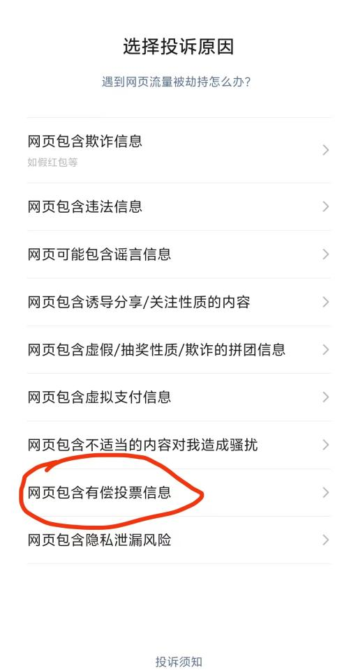

> 本文为当时的活动观察与个人意见。公开版隐去群号、活动入口和可识别的个人信息，不附私人聊天、付款凭证和内部材料原图。文中所述疑点不等于已认定违规或诈骗。

## 引言

据我的记录，2026 年 2 月 10 日，班级官方群里出现了“一盆新绿，一份关爱”活动的通知。与此同时，不少学生群也在讨论此事。有人质疑活动是否由学校主办，也有人想起上学期在第二课堂活动平台上见过的“光影护童心”活动。以公益为主题、与校内学生组织合作、奖品包括电子产品和志愿者证书，再加上付费助力，这些要素让我想到了被称为“钻石投票”的有偿投票模式。

根据宣传图片和活动群的消息，活动分为线上和线下两部分。线下由校内某学生组织主办，内容包括绿植领养、书写寄语卡片等；线上则是在指定网站上制作电子明信片、上传生活照片，并开展投票。主办方宣称，达到一定票数（网站称“爱心值”）后，将为留守儿童捐赠相应物资。

在活动网站里，除了投票按钮，还有一个“更多助力”按钮。页面显示，参与者可付费增加票数，所选项目同时对应不同价值的物资。按当时的奖项宣传，45 爱心值对应“两小时志愿时长”和活动证明；199 爱心值对应“县级志愿者证书”，宣传还称可用于综测加分。前三名的奖品包括小米音响、华为手环和联想平板电脑，部分奖项还宣传有省级志愿者证书或国家级媒体报道。证书或时长能否被学校实际认定，仅凭活动宣传无法确认。

根据我当时收集的公开帖子，有人以赞助校园活动为由接触学生组织，希望借校内渠道宣传线上投票。帖子中的个人经历不能证明本次活动有同样的问题。即便奖品、捐赠和证书最后都能兑现，付费票数与综测、志愿证明和排名挂钩，仍然值得关注。

## 哪些地方值得核查

### 网站、投诉与排名

活动通知提供的是一个电子书入口，点开后会跳到第三方活动页面。我当时在页面上看到校内学生组织的简称，但没有找到清楚说明实际运营主体的信息。向微信投诉后，我曾看到原链接无法访问；后来从同一个入口进入时，页面仍可通过其他地址打开。这些观察只能说明当时的访问情况，不能确认页面后台的运行方式。

*当时的微信网页投诉界面设有“网页包含有偿投票信息”选项。这张截图只说明投诉入口的设置，不代表微信已对本次活动作出认定。*

我打开排行榜时，页面显示“暂无排行”。活动群当时也处于全员禁言状态。在缺少公开排名和可核对计票规则的情况下，参与者很难验证名次和票差。原记录担心后台数据可能被人为更改，但我没有证据表明本次活动实际发生了改票。

### 奖品、证书和媒体报道

奖项页面提供了联想平板电脑的图片，未写明具体型号、配置或新旧状态。有关志愿服务时长和证书，宣传材料没有给出足以确认校方认定的依据。活动群用来说明媒体报道的材料中，至少有一篇页面注明是转载。转载页面不能证明活动承诺的报道会如何兑现。

### 合作方与收款方

协会介绍的合作方使用了一个公益组织名称。我当时以该名称在中国社会组织政务服务平台查询，未找到对应登记；原记录保留的付款凭证显示，收款商户使用的是另一家公司名称。单次名称查询无法确认组织的全部资质，收款方名称不同也不能单独说明资金去向，但合作方、页面运营者、收款方和捐赠执行方各自负责什么，应当事先说清楚。

我与协会负责人沟通后，对方表示正在联系合作方整改。随后，活动群和班群提醒同学不建议花钱。另一起活动的材料中，我也曾看到盖章的物资捐赠单；它属于不同活动，不能用来证明本次活动的捐赠已完成。

## 为何要关注此事

活动推送到班级群或第二课堂平台后，参与者容易把校内渠道的宣传理解为学校对付费规则、证书和奖项的背书。如果活动引发争议，受影响的除了参与者，还有学生组织的信誉和学校的审核机制。我从其他高校同学那里听到了类似的担忧，也看到过高校对有偿投票发出的风险提醒。这些提醒说明有必要提前核查，并不能代替对本次活动的判断。

学生组织需要赞助，部分同学希望通过证书和活动经历获得综测加分。当赞助、付费助力和综测宣传被放进同一个活动里，公益目标就容易被排名和奖励挤到一旁。

## 我给出的建议

鉴于这个活动的投票已经开始，不少学生也已投入资金，我当时的建议是先不要强行叫停活动。也有同学是奔着志愿者证书去的，希望增加自己在保研评奖时的竞争力，愿意为此投入资金。

“悟已往之不谏，知来者之可追。”接下来要做的，便是通过多方协作，尽量减少此类活动的滋生。如果再次遇到疑似有偿投票的活动，建议学生组织慎重签约，普通同学也应谨慎参与。我能做的是记录这些材料、提出个人之见，为高校社会的公平尽一份绵薄之力。
