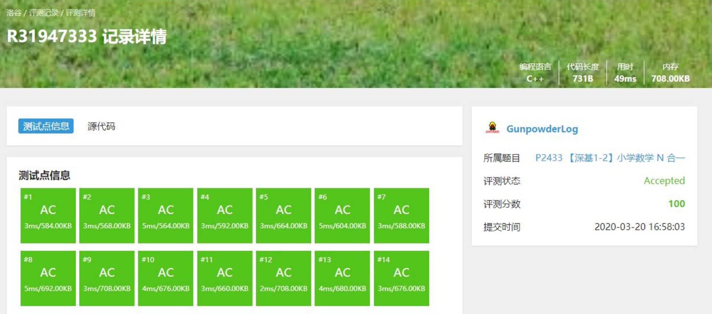
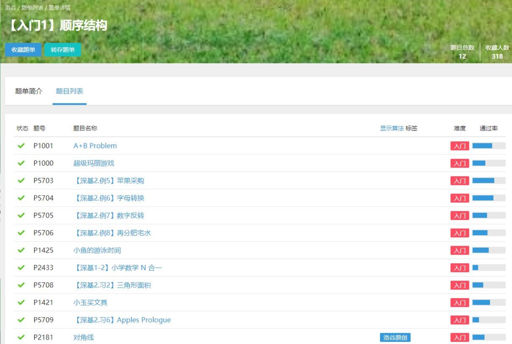

> 本文迁移自[博客园原文](https://www.cnblogs.com/gunpowder/p/12532901.html)，保留原始发布日期与当时的内容。

[https://www.luogu.com.cn/problem/P2433](https://www.luogu.com.cn/problem/P2433)

全谷最复杂的简单题。

题目描述

问题 1

请输出 I love Luogu!

问题 2

这里有 10 个苹果，小A 拿走了 2 个，Uim 拿走了 4 个，八尾勇拿走剩下的所有的苹果。我们想知道：

小A 和 Uim 两个人一共拿走多少苹果？

八尾勇能拿走多少苹果？

现在需要编写一个程序，输出两个数字作为答案，中间使用空格分开。

问题 3

现在有 14 个苹果。要均分给 4 名同学，分不掉的苹果放回冰箱。请问：

每位同学能分得几个苹果？

一共分出去多少苹果？

把几个苹果放回冰箱？

现在需要编写一个程序，输出三个数字作为答案，每个数字一行。

问题 4

现在有 500 毫升的肥宅快乐水，要均分给 3 名同学，每位同学可以分到多少毫升？请输出一个数字作为输出。保留 6 位有效数字，且不使用科学计数法。

问题 5

甲列火车长 260 米，每秒行 12 米；乙列火车长 220 米，每秒行 20 米，两车相向而行，从两车车头相遇时开始计时，多长时间后两车车尾相离？已知答案是整数。

问题 6

一个长方形长宽分别是 6cm、9cm，求它的对角线长度（cm）。直接使用 cout 输出。

问题 7

Uim 银行账户里面有100元。经过了下面的操作：

往里面存了 10 元；

购物花掉了 20 元；

把里面的钱全部取出。

请在每次操作后输出账户余额，并使用换行符隔开。

问题 8

当半径为 r=5，请输出圆的周长、面积和球体积。取 π=3.141593。请直接使用 cout 输出答案，每行一个数字。

问题 9

一只小猴买了若干个桃子。第一天他刚好吃了这些桃子的一半，又贪嘴多吃了一个；第二天他也刚好吃了剩余桃子的一半，贪嘴多吃了一个；第三天他又刚好吃了剩下的桃子的一半，并贪嘴多吃了一个。第四天起来一看，发现桃子只剩下一个了。请问小猴买了几个桃子？

问题 10

洛谷的评测任务是单位时间内均匀增加的。8 台评测机 30 分钟可以刚好把评测队列中的程序评测完毕，10 台评测机 6 分钟可以刚好把评测队列中的程序评测完毕，请问几台评测机可以在 10 分钟时刚好把评测队列中的程序评测完毕？

问题 11

小A跑步速度 5m/s，八尾勇跑步速度 8m/s，八尾勇在小A后面 100m，他们同时起跑，请问需要多长时间八尾勇可以追上小A？输出一个数字表示答案，使用 cout 直接输出。

问题 12

大家都知道有 26 个英文字母，其中A是第一个字母。现在请编程求出：

M 是字母表中的第几个字母？

第 18 个字母是什么？

输出一个数字和一个字母，使用换行隔开。

问题 13

小 A 有两块球形橡皮泥，一个半径是 4，一个半径是 10。他想把这两块橡皮泥揉在一起，然后塑造成一个正方体，请问这个正方体的棱长是多少？如果结果不是整数，则舍去小数点之后的数字。取 \\pi = 3.141593π=3.141593。

问题 14

根据咕咕网校的预测，当课程定价为 110 元时，会有 10 人报名。如果课程价格每降低 1 元，就会多 1 名报名者（反之亦然）。如果希望总共能收到 3500 元学费的话，那么应该定价多少呢？已知本题有两个答案符合要求，则取较小的那一个。如果这个答案不是整数，则需四舍五入精确到整数。

输入格式

输入一个数字，表示第几个问题。

输出格式

根据每个问题，输出一个答案。

---

这道题太恶心了，折腾了我1小时

答案很简单，就是计算费时。要是普及组出这么一道题，我直接撞墙

附上AC代码：

```cpp
#include <bits/stdc++.h>
using namespace std;
const double pai = 3.141593;
int main ()
{
int n;
cin >> n;
if (n == 1)cout << "I love Luogu!";
else if (n == 2)cout << 6 << " " << 4;
else if (n == 3)cout << 3 << endl << 12 << endl << 2;
else if (n == 4)cout << 166.667;
else if (n == 5)cout << 15;
else if (n == 6)cout << sqrt (117);
else if (n == 7)cout << "110\n90\n0";
else if (n == 8)cout << 10 * pai << endl << 25 * pai << endl << 125 * 4 / 3.0 * pai;
else if (n == 9)cout << 22;
else if (n == 10)cout << 9;
else if (n == 11)cout << 1.0 * 100 / 3;
else if (n == 12)cout << 13 << endl << "R";
else if (n == 13)cout<< 16;
else if (n == 14)cout << 50;
return 0;
}
```



好了，洛谷题单入门1顺序结构就这样AC完了，留个纪念


