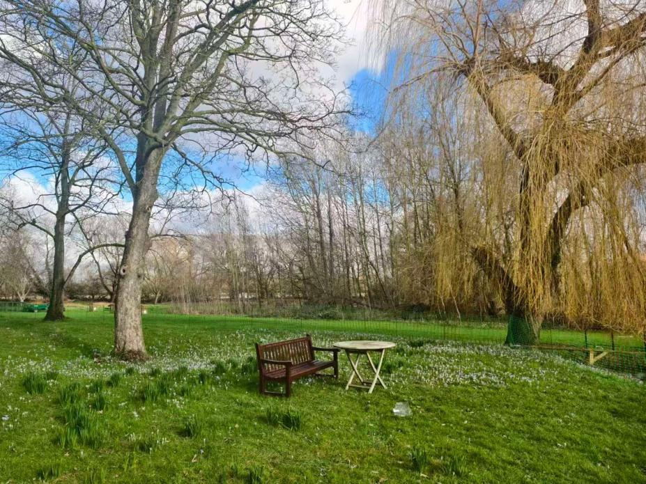
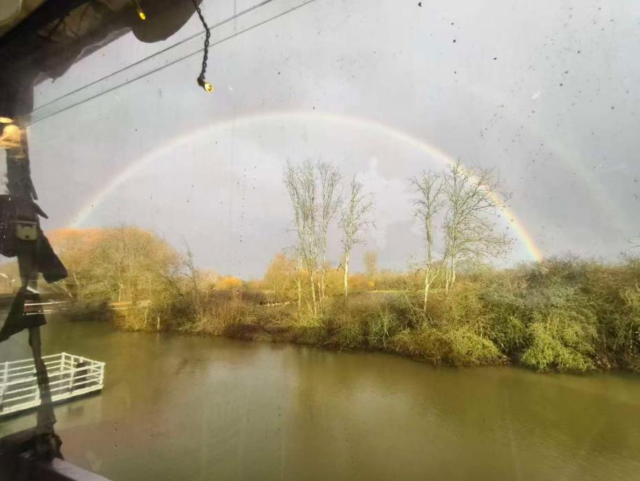

去牛津之前，我对它的想象大多来自照片——那些建筑的尖顶，草坪，和那著名的描写“the city of dreaming spires”。真正到了那里才发现，牛津的好看不止于明信片上的画面，更在你正好在那儿的时候。

每天下午课前，我从牛津中央绿地回教室，穿过Wolfson College的草坪。草地上开着一朵朵白色的小花，圆桌和椅子四处散布，一棵棵古老的垂柳点缀在周边。天很蓝，云压得很低，微风吹过，柳树发出沙沙声。一瞬间我仿佛置身梦境，这是我第一次真正体会到“如梦似幻”的感觉。后来我几乎每天都绕这条路回教室，在草地上驻足的一刻钟，思绪随着查韦尔河静静流淌。

更多的时候，牛津是日常生活。周末的集市里，肉铺、花店和卖饼干的铺子挤在一条窄巷，摊主会和熟客聊两句天气；Bodleian的圆顶雨后发亮，Radcliffe Camera前的台阶上永远有人坐着看书。这些地方游客很多，城市却没有为游客让路：公交车照样从人群边上挤过去，学生照样骑车穿过窄街。

一个阳光明媚的下午，我们在Cherwell Boathouse喝下午茶。抿一口地道的英式红茶，抬头看见两道彩虹压在河对岸的树线上，外面那道很亮，里面那道淡一些。同学们挤在窗边，谁都没说话，只有快门声。离开时，彩虹还在，只是角度变了，颜色慢慢淡下去。这张照片我一直留着，文件名是“牛津最好的一天”。

牛津没有围墙，学院散布在城市的各个角落。每个学院都像一个小小的宅邸，临街一扇门进去是方院，再往里是礼拜堂和食堂；街上买咖啡的人，可能就是某个学院的学者。我们跟着导航找Balliol College，来回走了两遍，才发现入口夹在一排店铺中间。城市包着大学，大学长在城市里，这和国内一整片校园很不一样。

往北到Stratford旅游，木筋墙的老房子挤在窄街两侧，屋檐滴着雨，莎士比亚故居门口排着长队，河边的天鹅不怕人，蹲下来拍照，它们会直接走过来；往南到温莎，城堡的圆塔压在山坡上。伦敦是另一副样子：地铁车厢窄、闷、噪声大，时刻表却几乎不差；国王十字车站的九又四分之三站台永远有人排队；大英博物馆的罗塞塔石碑前，永远有举着手机的人。

一路上，我也在比较中西的城市规划差异。英国的城市以两三层住宅为主，前院种花，街角有酒馆，傍晚灯一亮，生活气就出来了；而印象中美国的大城市更多是高楼和向外摊开的郊区。同样是发达经济体，人和街道的距离很不一样。这些零碎的观察被我记在手机备忘录里，回来整理时才发现，它们比任何一张明信片都更像我见过的英国。牛津的好看也不在明信片上，而在你正好在那儿：长椅空着，彩虹刚好出现，你抬头的时候，身边的人和你一起“哇”了一声。

## Wolfson College草坪

场景：雪滴花开时的午后，一张木长椅、一张白圆桌，右边是一棵垂柳。

故事：这是回教室的近路，我每天都走，只有那天停下来拍了照。

## Cherwell Boathouse的双彩虹

场景：1月27日下午茶后雨停，两道彩虹横在河对岸的树线上。

故事：同学们挤在窗边拍，谁也没说话……
