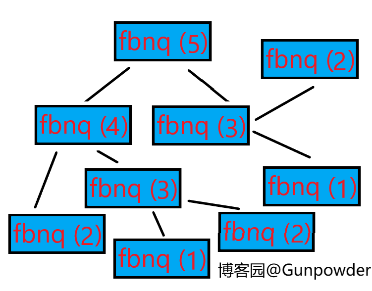
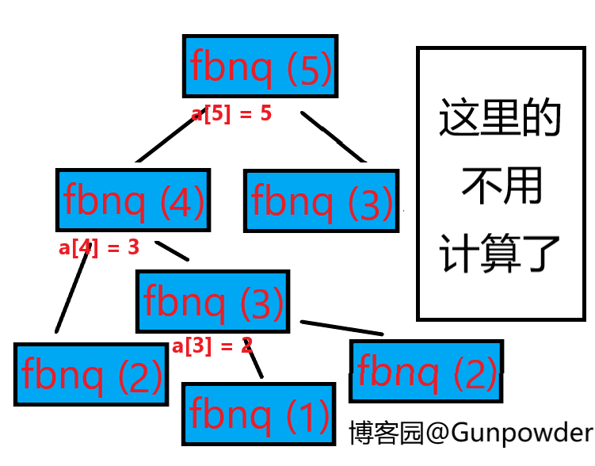

> 本文迁移自[博客园原文](https://www.cnblogs.com/gunpowder/p/12463589.html)，保留原始发布日期与当时的内容。

首先声明，作者蒟蒻，这篇随笔是给打普及组的童鞋写的

这两个名词大家肯定都不陌生，说实话，其实这还是挺简单的。

递归是一种深度优先搜索。深度优先搜索是将一个问题分解成多个子问题，子问题再分解或直接得到答案，直到所有的子问题都有了答案，再把所有的答案一一向前回溯，直到最终得到原问题的解。



用深度优先搜索计算斐波那契数列的第5项

这里定义了一个函数fbnq ()，括号内的数表示计算斐波那契数列的第几项。由此我们知道fbnq (n) = fbnq (n - 1) + fbnq (n - 2)，同时fbnq (1) = fbnq (2) = 1，于是可得上图。但仔细想想，这里面fbnq (3)被计算了2次，太麻烦了，有没有一种更好的办法，能记录fbnq (n)的值呢？

这个时候我们就要用到记忆化数组了。记忆化数组是用于记录每一次执行递归函数得到的解，以避免重复计算。这里用记忆化数组来计算fbnq (5)：



这里定义了记忆化数组a来记录每次函数执行的结果。附上代码：

```cpp
#include <bits/stdc++.h>
using namespace std;
int a[6];//定义记忆化数组a
int fbnq (int n)
{
if (n <= 2)return 1;//fbnq (1)和fbnq (2)都等于1
if (a[n] != 0)return a[n];//如果记忆化数组有记录则输出对应的项
a[n] = fbnq (n - 1) + fbnq (n - 2);//调用递归公式
return a[n];//递归出口
}
int main ()
{
cout << fbnq (5);//输出斐波那契数列第5项
return 0;
}
```

（本菜鸡不会渲染啊，向大佬求助QAQ）
以上就是递归的内容。接下来我们继续来扯递推：
递推跟递归差不多，但是不定义函数，直接通过一个数组来记录每次计算的答案，直到得到要求的解。掌握了递推公式，其实它也是很简单的。
附上用递推来求解斐波那契数列第5项的代码：

```cpp
#include <bits/stdc++.h>
using namespace std;
int main ()
{
int a[6] = {1, 1};//定义递归数组a，前两项为1
for (int i = 3; i <= 5; i++)//从第三项开始递推
{
a[i] = a[i - 1] + a[i - 2];//递推公式
}
cout << a[6];//输出a的第6项，即斐波那契数列第5项
return 0;
}
```

是不是简单多了？
今天就扯到这里，我们下次再见
