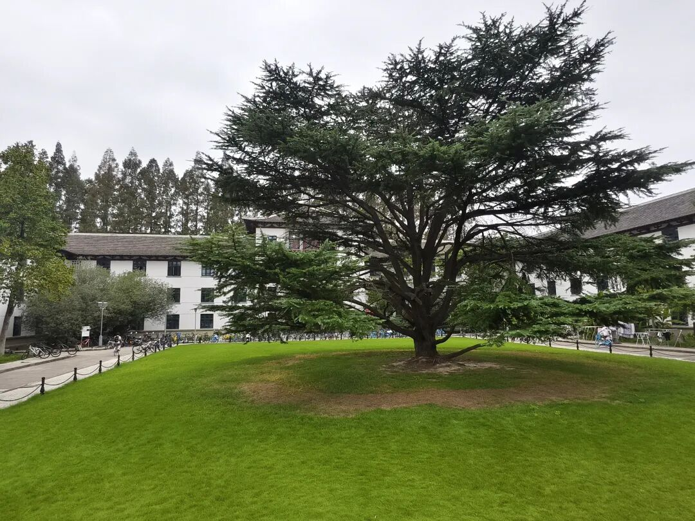

> 原文于 2025 年 10 月 15 日发布于微信公众号「同济大学未来技术班」。

同济大学未来技术班公众号由我在2025年8月25日建立，到今天10月15日，已经经历了52天的光阴。在这些美好而珍贵的日子里，我作为一名同济大学2025级未来技术班新生，捕捉了新生入学教育的各个画面，记录了同学们的与活动与成长、汗水与收获。

然而，随着开学季的结束，未来技术班的集体活动逐渐减少，而导论课的活动也开始由国豪书院公众号报道。四个班级的同学们纷纷建立了自己的班级公众号，在本公众号的投稿也显得不那么重要。

不论是记录活动还是留下回忆，同济大学未来技术班公众号已经完成了它的使命。鉴于公众号目前的状况,我将不得不辞去我作为公众号建立者和第一运营者的职务。

虽然未技公众号的故事结束了，但未技同学们的故事并没有结束。本公众号并不会注销，而将会以一种崭新的形态延续——不论是继续进行活动记录，还是作为一个学生树洞，亦或是用来通知未技学子的生日，甚至像“花椰菜的回忆花园”公众号那样用来记录下我在象牙塔生活的随笔，一切还尚未知晓。**因此，本公众号的命运将由您来决定。欢迎同济学生和社会各界人士把自己对这个公众号的愿景留在评论区里，**我将根据大家的想法，把这个公众号打造成一片崭新天地。

最后，感谢大家一直以来对公众号的支持，这是我第一个运营微信公众号的经历，虽充满遗憾，但在我的人生路上也是一笔宝贵的财富。

**书院的年轮继续流转，我也将怀着炽热的心胸坚定向前。**

致瞬息万变之物，及亘古不变之物。
