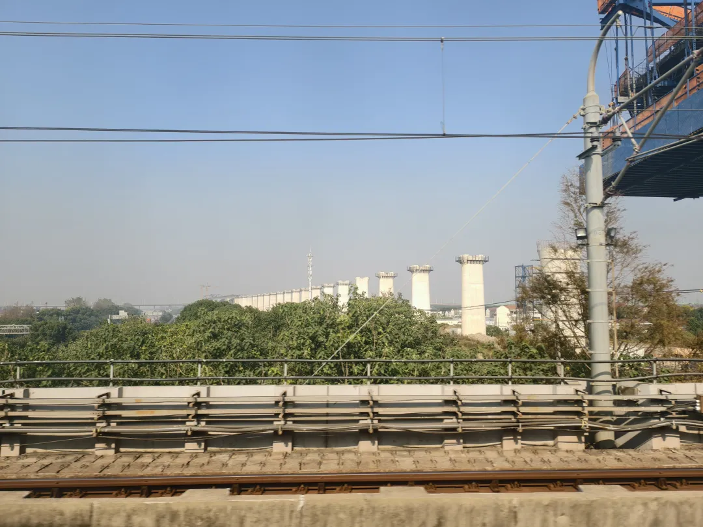
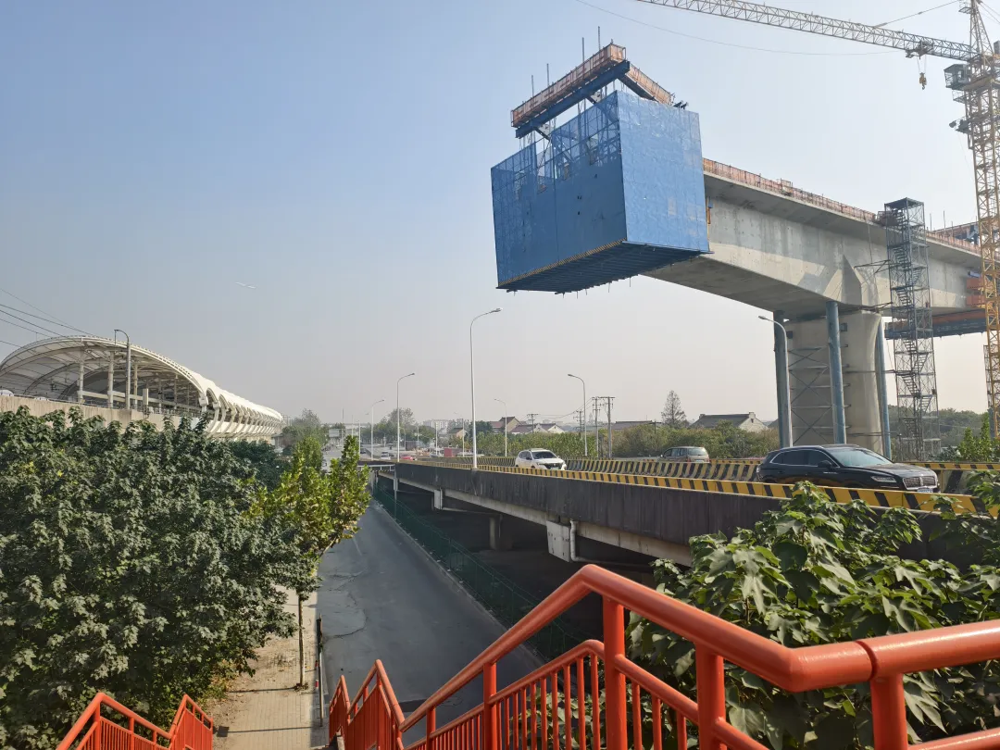
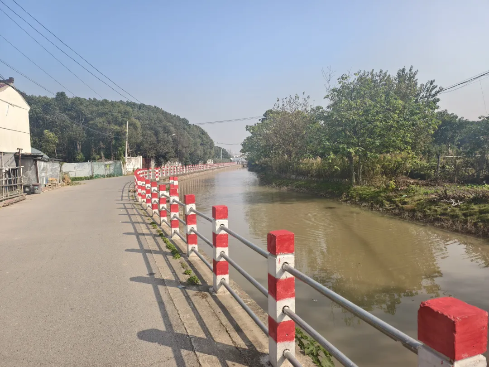
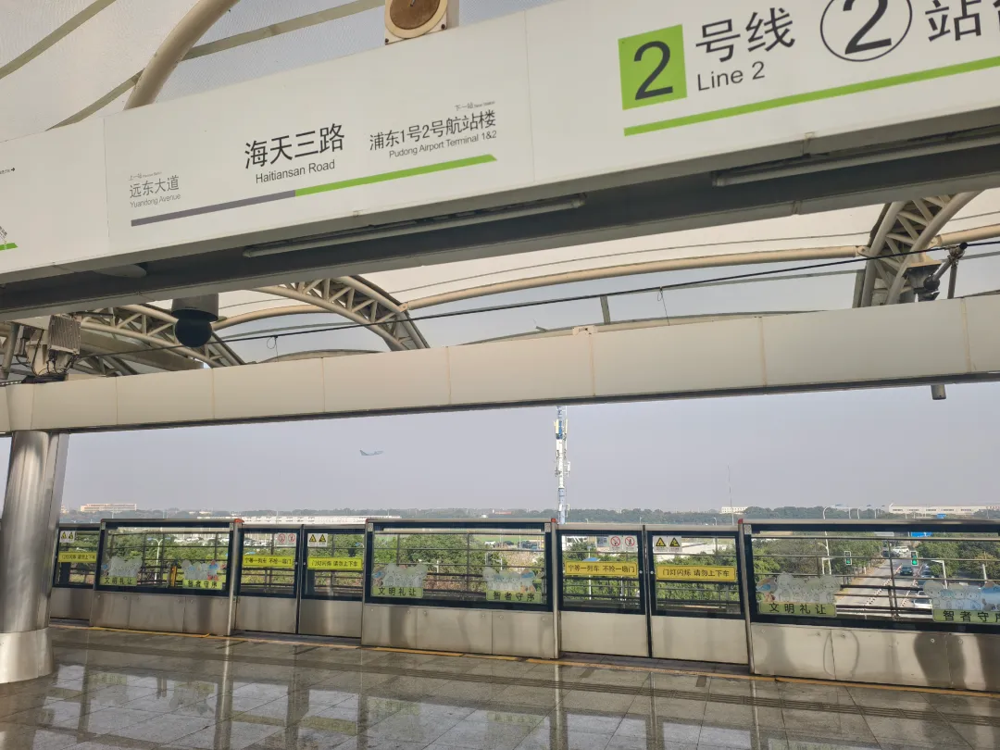

以我们院命名的全国本科生学术论坛，翘了；

鸿蒙在徐家汇搞的开发者活动，没赶上；

怀着期中周结束的释然和对未来及当下的怅惘，我独自一人登上了 2 号线的列车——

*二号线如今已全线采用 8 节编组，列车经过龙阳路站后便逐渐空了下来，仿佛把城市的喧嚣一节节甩在了身后。*

在上海这座昼夜奔涌的都市，我愿顺从内心休憩。

上海人没有睡午觉的习惯，但我不睡午觉只会导致一下午的疲惫。觉必须睡，这是奶茶咖啡也救不来的。小镇做题家的那套意识形态在大学的节奏中渐渐褪色，我才意识到自己原本就是不愿意内卷的那类人。

父亲总教导我，上海人讲究守时，在这座城市生活必须把控时间、追求效率。可私以为，对那些并不重要的事务强行塞满日程，只会让人变得机械。当我终于从初等教育的一线式学习跨入高等教育的项目化学习，才真正明白追逐灵魂自由的人为何甘愿在世俗浪潮间划出自己的航线。

列车行至远东大道，我从二号口下车，向北迈向合庆镇。高德地图上的角落打卡不说是我的执念，但也带着几分强迫症的意味。然而，上海错落有致的乡镇级行政区划，使得想通过坐地铁刷遍全城的人，总是要下车感受一下大地的脉搏。

*上海沿江通道浦东段正在如火如荼地建设，这里未来将成为沪苏通铁路抵达上海东站的最后一段*

我骑着共享单车横穿田野。初冬提前降临东滩，菜园的大棚已经支起；塔吊撑起新农村建设的骨架，鸣唱着浦东延展的乡音。沿着森林路进入森林村，这里有儿时记忆中的酸奶配送箱，也有散落各处、标着旧行政区划的牌子。外卖配送员骑着电驴在村中穿梭，鸡犬之声此起彼伏，不时有几辆挂着外地牌照的小轿车擦肩驶过。

沿着森塘路出村，与郊环线一墙之隔，我只得一路向东。越往前走，农田越开阔。河对岸是一畦畦油麦菜，和散养的鸡与山羊。浦东机场起降的客机从头顶掠过，嗡鸣声像低沉的潮水。一路上大多房屋已人去楼空，唯一的水果合作社也成了杂物堆场。可这座濒临地铁站与佛罗伦萨小镇的村庄仍带着现代化的气息，走几步就会遇到一个小花园，或一处健身器材的空地。

*这条小河被简单粗暴地命名为“森林 21 号河”，但测量的河道长度竟然精确到了厘米*

跨过东横港桥，终于进入合庆镇界。身旁是上海轨交的川沙基地，再往前便接入了大路。随着高德地图“待点亮”的指示倏然亮起，我终于可以打车回地铁站了。而对于远在天边的老港，我还是等南汇线开通，或是下次远征临港时再去探寻吧。毕竟，人总要给自己留些尚未抵达的地方，那才是向着希望田野继续出发的理由。

我一直觉得，二号线是上海最浪漫的地铁线路——从虹桥机场姗姗而来，经过北新泾和中山公园的商圈，聆听静安寺的庄严，穿越繁华的南京路步行街，从东方明珠的倒影间钻入浦东中心。它见证世纪大道的纵深、世纪公园的绿意，从龙阳路枢纽折向东南，驶入高科区、唐镇与日新月异的川沙。从凌空到远东，直到吹响海天三路的号角，在多线交汇的高潮中迎来浦东机场的尾声。

为探寻上海的浪漫，我又一次坐上了开往浦东机场方向的二号线列车。22 年刚到上海，年轻不懂事以为一直往东走肯定能见到海。我先公交后地铁，走过大路和小路，穿过树林和田野，沿着围场渠慢慢溜达了一个多小时终于还是没看到。日暮回程时，在海天三路的站台上听到了轮船的汽笛声。

*海天三路站已进入浦东机场的管辖区，电信正在提醒我开通国际漫游。一边是上海最后的城建区，一边是离大海仅三公里的田野。那一刻我忽然明白，有些风景不必抵达就已足够浪漫。*
